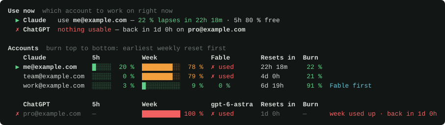
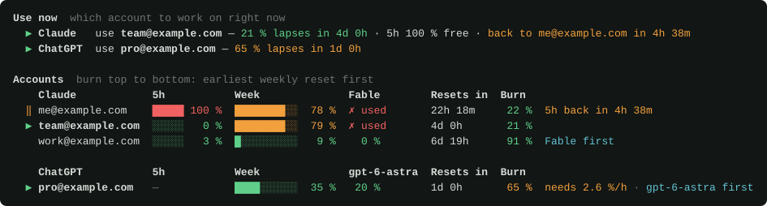
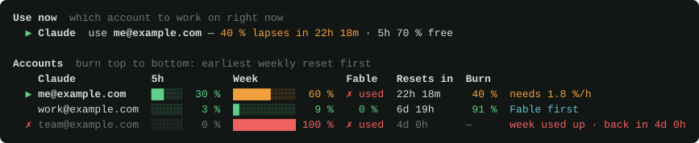
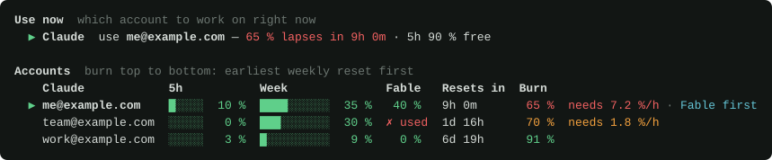
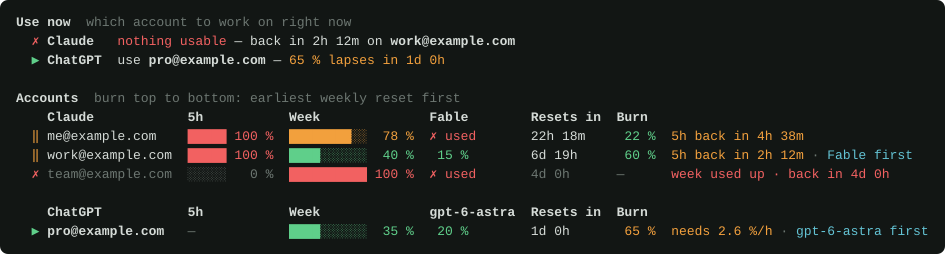
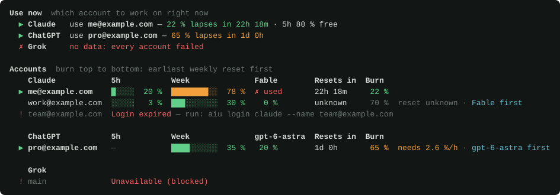

# aiu — AI subscription usage

Shows the current usage limits of your AI subscriptions (Claude, ChatGPT/Codex, Grok) in one table.
Uses each subscription's own login (OAuth / browser session), not API keys. macOS only.

## Install

Requires Node 24.2+.

```bash
npm install
npm link        # puts `aiu` on your PATH
```

`aiu` runs straight from this clone, so `git pull` is the whole update; the post-merge hook (see
[Development](#development)) runs `npm ci` when the dependencies changed.

## Usage

```bash
aiu login claude                     # opens the browser; paste the code shown after login
aiu login chatgpt                    # opens the browser; returns automatically
aiu login grok --name main           # paste the cookie header and user agent from grok.com DevTools
aiu                                  # which account to use now, then all accounts in burn order
aiu --json                           # same, machine-readable
aiu accounts                         # list configured accounts
aiu remove claude/me@example.com     # forget an account
```

`aiu` prints two sections:



`Use now` names, per service, the account to work on: the one whose weekly limit resets first (an
unknown reset counts as last), so as little allowance as possible lapses unused. It skips accounts whose
5h or weekly limit is used up and accounts that report neither limit. Accounts with less than 10 % of
their 5h window left come last, because they would stop again within minutes, and accounts without a
weekly limit come after those with one. When an account due earlier is only waiting for its 5h window,
the line says when to switch back to it. When no account is usable, it says which one frees up first.

`Accounts` lists every account per service in the order to burn its weekly allowance. `▶` marks the
account to use now, `‖` one waiting for its 5h window (it keeps its place in the order), `✗` one whose
weekly limit is used up (listed after the others, by when it frees up) and `!` one that failed, with the
command that fixes it. The columns are shared by all services, so a service without a 5h window shows `—`.
Bars are green below 50 %, yellow from 50 % and red from 80 %; a used-up limit is always red. Each
model with its own limit (e.g. Fable) gets a column: a used-up model shows `✗ used` when it comes back with
the weekly reset, `✗` with its own countdown when it comes back at another time, and `✗ unknown` when
that time is not known. `Fable first` marks the first account in the
order that still has room for it. `Burn` is how much of the weekly allowance is left, coloured by the
pace needed to use it up before the reset: green below 1.5 %/h, yellow up to 3 %/h, red above, and the
note names that pace once it is 1.5 %/h or more.

### What it shows in other situations

The images below are the real output for made-up accounts, rendered by `npm run docs:examples`.

**The account due first has a full 5h window.** It keeps its place in the order, marked `‖` with the
time its window frees up. `▶` moves to the next account, and `Use now` says when to switch back.



**A weekly limit is used up.** The account moves below the burn order with `✗` and the time it frees up.
Its used-up limits stay red, the rest of the row is dimmed.



**Allowance is about to lapse.** The order stays by deadline, but `Burn` turns yellow or red when the
pace needed before the reset gets high, and the note names that pace.



**Nothing is usable right now.** `Use now` says which account frees up first and when. Accounts waiting
for their 5h window stay in the order, the one with a used-up week goes below it.



**Errors and missing data.** A failed account is listed last with the command that fixes it, an account
without a known reset goes after the ones with one, and a service whose accounts all failed says so.



`aiu --json` prints the same data for scripts: each limit carries a `kind` (`session`, `weekly` or
`model`) when known, and a top-level `recommendation` object holds the advice (`providers`, `models` and
`plan`).

Without `--name`, `aiu login` labels a Claude or ChatGPT account with the e-mail it logged in with,
e.g. `claude/me@example.com`. Logging in again to an account `aiu` already knows, even one added under
another label, renews that account instead of adding it twice. Pass `--name` for a shorter label, or
when one e-mail has several subscriptions (e.g. a personal and a team plan) and each needs its own
label. `--name` uses exactly the label given, so to rename an account, log in with the new name and
remove the old entry (`aiu remove claude/me@example.com`). Grok does not report the e-mail, so
`aiu login grok` always needs `--name`.

To add several accounts of the same service, switch the account in the browser
(or use a private window) before each `aiu login`.

Grok has no login API, so `aiu login grok` stores the `cookie` header and user agent of a logged-in
grok.com tab (the command prints where to copy them). Paid plans show their weekly usage pool, free
accounts their query quota. The cookie cannot be refreshed: when grok.com logs it out, the row says
`Login expired` and you paste a fresh one. If Cloudflare refuses the request, the row says
`Unavailable (blocked)`.

## How it stores things

- Tokens: macOS Keychain, service `ai-usage` (never in plain files, never in process arguments).
- Account list (no secrets): `~/.config/ai-usage/accounts.json`.
- Each account has its own login, separate from Claude Code and Codex, so `aiu` never logs those tools out.

The usage endpoints are unofficial and may change without notice.

## Development

```bash
npm test
npm run typecheck
```

`npm ci` wires two Git hooks (`HOOK_SKIP=1` skips either):

- pre-push runs the typecheck and tests before a push that changes code. CI runs the same checks on
  every PR that changes code.
- post-merge runs `npm ci` after a `git pull` that changes `package-lock.json`, so the linked `aiu`
  keeps working after an update.
